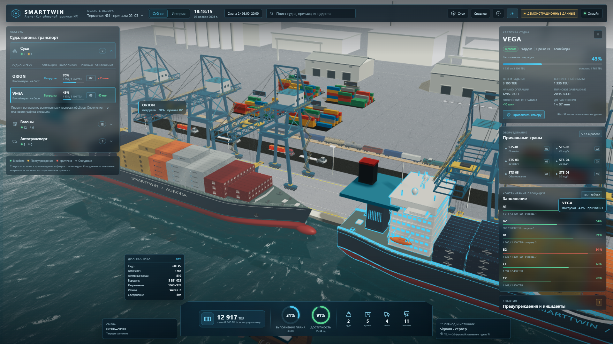
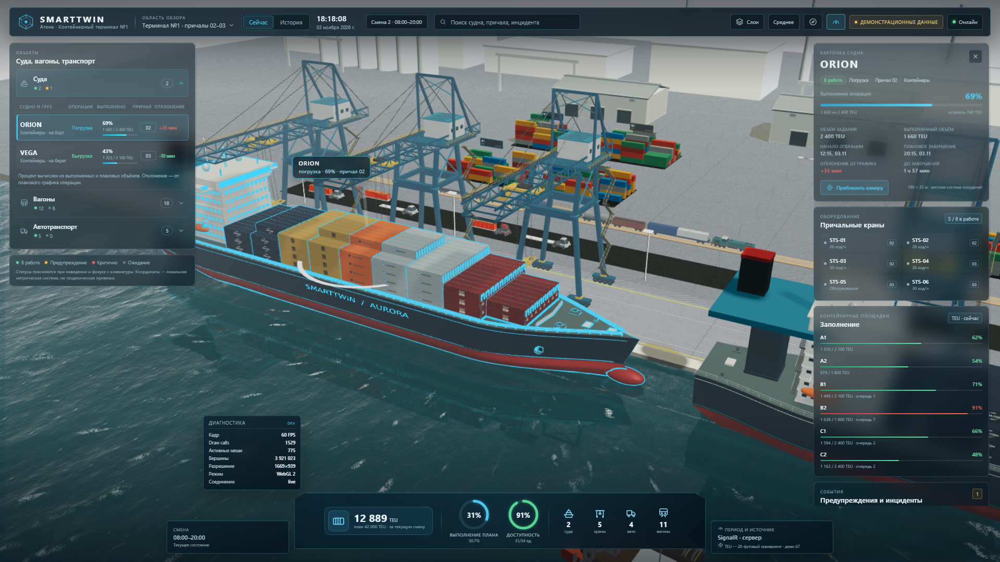
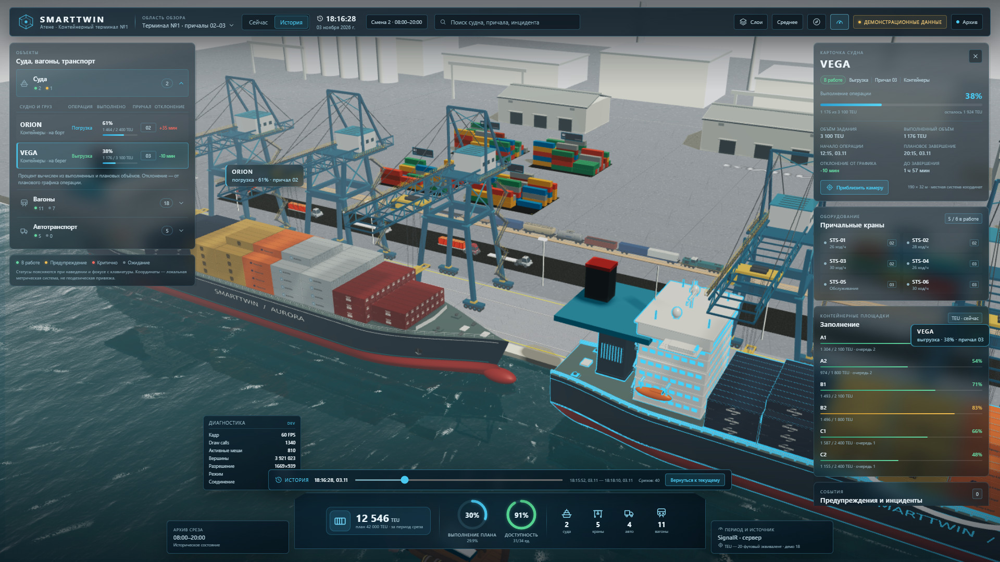

# Smarttwin — цифровой двойник контейнерного порта

Демонстрационный прототип цифрового двойника контейнерного терминала: интерактивная 3D-сцена порта, оперативные панели, история состояния и поток обновлений через сервер.



| Список судов и карточка | Просмотр истории |
| --- | --- |
|  |  |

Дополнительно: [обзор 2560×1440](docs/screenshots/overview-2560.png).

## Что реализовано

- 3D-сцена терминала: акватория, два причала, суда **ORION** и **VEGA**, шесть причальных кранов, контейнерные площадки, склады, железнодорожный состав, дорога с автотранспортом, буксир.
- Параметрическая геометрия без внешних ассетов, дневное освещение, тени, анимированная вода, подписи судов и площадок, выбор объектов мышью.
- Камера с ограничениями, плавным приближением к объекту и возвратом к исходному ракурсу.
- Панели в стиле диспетчерского интерфейса: верхняя панель, список объектов, оборудование, заполнение площадок, инциденты, нижний блок показателей.
- Согласованные проценты: список, карточка, подписи в сцене и показатели используют одни и те же объёмы.
- История: пауза живого потока, выбор момента, возврат к текущему состоянию.
- Устаревание данных, порядок обновлений, переподключение и повторное получение снимка после восстановления связи.
- Сервер ASP.NET Core с EF Core, PostgreSQL/PostGIS, миграцией, REST API и SignalR.
- Docker Compose с PostgreSQL/PostGIS, API и Nginx; конфигурация через `.env`.
- Юнит-тесты расчёта процентов и обработки устаревших/неупорядоченных обновлений; E2E-проверка сцены и интерфейса.

## Стек

| Слой | Технологии |
| --- | --- |
| Клиент | React 19, TypeScript 5.9, Vite 7, Babylon.js 8 (WebGL 2 / WebGPU), SignalR JS |
| 3D | Babylon.js 8.56.2, glTF-лоадер, Havok Physics 1.3.14 |
| Сервер | .NET 9, ASP.NET Core Minimal API, SignalR, EF Core 9, Npgsql |
| Хранилище | PostgreSQL 17 + PostGIS 3.5 |
| Инфраструктура | Docker Compose, Nginx, multi-stage Dockerfiles |
| Проверки | Vitest, Playwright Core (Edge), скрипты smoke-проверок |

Версии зависимостей зафиксированы в `client/package.json` и `server/Smarttwin.Api/Smarttwin.Api.csproj`.

## Структура

```text
Athene/
├─ client/
│  ├─ src/
│  │  ├─ scene/            # Babylon.js: сцена, вода, суда, краны, площадки, транспорт
│  │  ├─ ui/               # панели, список судов, карточка, история, диагностика
│  │  ├─ state/            # хранилище состояния интерфейса и выбора
│  │  ├─ data/             # серверный источник SignalR, демо-источник, слияние обновлений
│  │  ├─ metrics/          # проценты, устаревание и тесты
│  │  ├─ domain/           # типы, константы, геометрия терминала
│  │  └─ utils/            # форматирование
│  ├─ scripts/             # E2E, smoke-проверка SignalR, скриншоты
│  ├─ nginx.conf
│  └─ Dockerfile
├─ server/
│  ├─ NuGet.Config
│  ├─ Smarttwin.Api/
│  │  ├─ Contracts/        # DTO состояния и обновлений
│  │  ├─ Data/             # EF Core, PostGIS-сущности, миграции
│  │  ├─ Demo/             # детерминированная симуляция, сеятель, хранение, worker
│  │  └─ Hubs/             # SignalR-хаб
│  └─ Dockerfile
├─ docs/screenshots/
├─ docker-compose.yml
├─ .env.example
└─ plan.md
```

## Быстрый запуск через Docker Compose

Требуются Docker Desktop и свободные порты `8080` (UI), `5080` (API), `5433` (PostgreSQL на хосте).

```bash
cp .env.example .env
docker compose up --build
```

Открыть: [http://localhost:8080](http://localhost:8080).

Проверка API: [http://localhost:5080/api/health](http://localhost:5080/api/health).

Остановить: `docker compose down`. Полностью сбросить демо-БД: `docker compose down -v`.

Nginx раздаёт собранный клиент и проксирует `/api/` и `/hubs/` (WebSocket) в контейнер `api`. Внутри Compose пароль БД берётся из `POSTGRES_PASSWORD`; значения по умолчанию предназначены только для локального демо.

## Локальная разработка

Требуются .NET SDK 9, Node.js 22.12+ (или новее), npm 10+ и запущенный Docker для PostgreSQL.

1. Запустить только базу:

```bash
docker compose up -d db
```

2. Запустить API (из PowerShell):

```powershell
cd server
dotnet tool restore
$env:ConnectionStrings__Postgres="Host=localhost;Port=5433;Database=smarttwin;Username=smarttwin;Password=smarttwin"
dotnet run --project Smarttwin.Api
```

При старте API применяет миграции, очищает и заново заполняет демонстрационную историю, затем запускает симуляцию с шагом 2 секунды.

3. Запустить клиент:

```bash
cd client
npm ci
npm run dev
```

Vite проксирует `/api` и `/hubs` на `http://localhost:5080`. При недоступном API клиент автоматически переходит на локальный демо-источник и показывает это в верхней панели; кнопка «сервер?» повторяет подключение.

### Полезные команды

```bash
# клиент
cd client
npm run typecheck
npm run test
npm run build

# сервер
cd server/Smarttwin.Api
dotnet build
dotnet tool run dotnet-ef migrations list --project . --startup-project .

# проверки (нужны запущенные PostgreSQL, API и Vite)
cd client
npm run smoke:signalr
npm run verify:e2e
npm run verify:motion
npm run verify:traffic
npm run verify:water
npm run screenshots
```

`verify:e2e` сам останавливает и запускает локальный API на `5080`, использует БД на `5433` и Vite на `5173`. Перед запуском убедитесь, что эти порты свободны. `verify:motion` API не трогает: он открывает сцену в Edge, снимает покадровые трансформации и пишет отчёт в `client/scripts/motion-report.json`.

Если во время правок модулей сцены (PortScene, client/src/scene/water/) страница выглядит недостроенной — часть объектов есть, части нет, — это dev-сервер перезагружает сцену на лету: нужен жёсткий refresh (Ctrl+Shift+R). В production-сборке такого режима нет.

## Демонстрационный сценарий

- **ORION**, причал 02, погрузка: 1 632 / 2 400 TEU → **68%**.
- **VEGA**, причал 03, выгрузка: 1 302 / 3 100 TEU → **42%**.
- Через ~12 секунд после старта появляется предупреждение по площадке **B2** (заполнение 91%, очередь 7 машин). Выбор предупреждения выделяет площадку в сцене и приближает камеру.
- Каждые 2 секунды обновляются объёмы, позиции транспорта, загрузка кранов, KPI и, при необходимости, предупреждения.
- Работают: выбор судна в списке и в сцене, карточка судна, приближение, возврат камеры, слои, качество графики, поиск, история и переподключение.

## Архитектура данных

### Источник истины

Сервер владеет координатами, объёмами, статусами, предупреждениями и KPI. Клиент не вычисляет бизнес-состояние из визуальных допущений: он отображает полученный снимок и интерполирует только движение уже известных объектов.

- Стартовый снимок: `GET /api/state` и событие SignalR `snapshot` при подключении.
- Обновления: событие `delta` каждые 2 секунды. В delta передаются только изменившиеся объекты (`vessels`, `cranes`, `trucks`, `tugs`, `yards`, `train`, `warnings`, `kpis`).
- Порядок: у снимка и delta есть `sequence` и `serverTime`. Клиент отбрасывает устаревшие и повторные delta; снимок с меньшим `sequence`, но более новым `serverTime`, принимается как новый эпоха после перезапуска сервера.
- Устаревание: при возрасте данных ≥ 7 секунд показывается предупреждение, ≥ 20 секунд — состояние «нет связи». Движение после получения последней delta не экстраполируется.
- Переподключение: SignalR автоматически переподключается, клиент повторно запрашивает снимок; при длительной потере связи выполняется повторный запуск источника, иначе остаётся явно помеченное последнее состояние.

### Проценты и периоды

- Процент операции судна: `completedTeu / plannedTeu`, ограничение 0…100.
- Выполнение плана: `teuHandled / planTeu` за период смены.
- Доступность оборудования: `availableEquipment / totalEquipment` на момент снимка.
- Заполнение площадки: `occupiedTeu / capacityTeu`.
- Показатели «за период» (обработано, план) визуально отделены от показателей «на момент» (доступность, ресурсы, заполнение). Подсказки при наведении и фокусе объясняют смысл.

### История

- Сервер сохраняет снимок состояния в `state_snapshots` каждые 2 секунды, хранит последние 30 минут.
- При старте создаётся демонстрационная история за последние 2 минуты, поэтому просмотр доступен сразу.
- `GET /api/state/history` возвращает доступные точки, `GET /api/state/at?at=<ISO-8601>` — ближайший снимок.
- Клиент при входе в историю приостанавливает применение живых обновлений, показывает выбранный срез и при возврате запрашивает актуальное состояние.

### REST API

| Метод | Маршрут | Назначение |
| --- | --- | --- |
| GET | `/api/state` | Текущий снимок состояния |
| GET | `/api/state/history?minutes=30` | Доступные точки истории |
| GET | `/api/state/at?at=...` | Снимок на указанный момент |
| GET | `/api/health` | Состояние API, БД и симуляции |

### SignalR

- Хаб: `/hubs/port`.
- `snapshot` — полный снимок при подключении.
- `delta` — инкрементальное обновление.
- Клиент: `withAutomaticReconnect`, повторный снимок после восстановления.

## База данных и PostGIS

Миграция создаёт расширение `postgis` и таблицы:

- `port_objects` — последнее состояние объектов; позиция хранится как `geometry(Point, 32637)`, операционные поля — в `jsonb`;
- `state_snapshots` — снимки для истории, полезная нагрузка в `jsonb`;
- `warnings` — предупреждения и их активность.

`32637` — локальная метрическая система (UTM 37N), выбранная как удобная метрическая привязка. Это **демонстрационные координаты**, а не результат геодезической съёмки; при подключении реальных данных нужен собственный источник координат и проверка SRID.

Миграции:

```bash
cd server
dotnet tool restore
dotnet tool run dotnet-ef migrations list --project Smarttwin.Api --startup-project Smarttwin.Api
```

## 3D-сцена

- Babylon.js `Engine` (WebGL 2) с аппаратным масштабированием по уровню качества. 3D-модуль загружается лениво: основной бандл ~328 КБ, сцена ~2,4 МБ (gzip ~600 КБ); вода добавляет ~45 КБ (~15 КБ gzip).
- Вода — четыре FFT-каскада 128×128 на GPU (перенос из Ultra-Water) и планарное отражение; без внешних текстур, см. «Вода акватории».
- Контейнеры объединены в батчи по цветам; шпалы, отбойники и дорожная разметка используют thin instances.
- Тени — `ShadowGenerator` с размером карты, зависящим от качества; мелкие детали (колёса, окна, маячки, тросы) исключены из теней.
- Подписи судов и площадок — динамические текстуры; проценты в сцене пересчитываются из тех же объёмов, что и в списке.
- Выбор объекта — пикинг по метаданным `entityId`; выделение контуром и пульсирующим маркером; список и карточка синхронизированы со сценой.
- Quality: `low / medium / high` меняет масштаб рендера и размер карты теней. При `prefers-reduced-motion` анимации интерфейса отключаются.
- WebGL 2 — основной проверенный backend. Точка создания движка локализована в `PortScene`; WebGPU не включается автоматически, чтобы не показывать непроверенный режим. Для включения нужен `WebGPUEngine`, проверка `navigator.gpu`/`IsSupportedAsync` и отдельная проверка шейдеров и теней.

## Движение техники

Положение и курс машин считаются в цикле отрисовки, а не в момент прихода
сообщения. Разбор причины рывков и новая схема — ниже.

### Почему техника двигалась рывками

Диагностика до правок: визуал хранил `target` (последнюю серверную точку) и
каждый кадр «догонял» её экспонентой `1 − exp(−Δt · 3,2)`. Отсюда все
симптомы:

- **Редкие обновления задавали темп.** Демо-источник присылает разность раз в
  2 с, а анимация шла только по этим точкам: между сообщениями машина
  разгонялась и замирала.
- **Движение через таймер сообщений.** Новая цель появлялась только в
  `setSnapshot` (вызов из React-рендера), поэтому частота движения совпадала
  с частотой состояния.
- **Телепорты.** При расстоянии больше `snapDistance` (90 м у машины, 150 м у
  буксира) объект переносился мгновенно.
- **Курс по Эйлеру.** `rotation.y` догонял угол линейно, без учёта периода;
  на развороте на 180° это давало перескок.
- **Срезание поворота.** Между двумя измерениями позиция интерполировалась по
  прямой, а разворот на концах причала — это дуга: машина шла по хорде.
- **Смещение часов применялось дважды** — к меткам измерений и к часам
  рендера. Сцена отставала на ~1,8 с и двигалась с чужой скоростью.
- **Оценка скорости отставала** (EMA 0,5 по сообщениям раз в 2 с), поэтому
  прогноз между сообщениями был короче реального и на каждом пакете
  накапливался скачок: на развороте — до 22 м за кадр.

Пересоздания объектов не было: `setSnapshot` обновляет существующие визуалы.
Задержки отрисовки тоже ни при чём — 60 кадров/с держались стабильно.

### Как считается теперь

| Файл | Роль |
| --- | --- |
| `client/src/scene/motion.ts` | `EntityMotion`: буфер измерений, пройденное расстояние, интерполяция, пределы прогноза |
| `client/src/scene/routes.ts` | маршруты демо-движения: причальный проезд (стадион) и эллипс буксира |
| `client/src/scene/motionSelfTest.ts` | детерминированные сценарии движения для проверки в браузере |
| `client/src/scene/PortScene.ts` | `onFrame` двигает визуалы, `setSnapshot` только складывает измерения |
| `client/src/state/store.ts` | `clockOffsetMs` подстраивается по каждой разности (EMA), а не один раз при подключении |

- **Измерение → расстояние.** Позиция из сообщения проецируется на маршрут и
  превращается в пройденное расстояние `s` с меткой времени сервера.
- **Движение по времени.** Между измерениями `s` интерполируется по времени, а
  положение берётся из `route.at(s)` — то есть по дуге, а не по хорде. Курс —
  касательная маршрута, посчитанная по хорде ±1,5 м, поэтому на угле он
  меняется плавно.
- **Ориентация.** `PortScene.applyHeading` доводит кватернион через
  `Quaternion.SlerpToRef` с постоянной времени ~0,17 с: поворот читается как
  поворот, а не как перескок.
- **Поправки растворяются.** Показанная позиция догоняет расчётную с
  ограничением скорости (`followPose` для телеметрии, ограничитель в
  пространстве `s` для маршрута): поправка любого размера разбирается примерно
  за секунду. Разрыв больше 45 м переносится сразу — это случай долгого
  отсутствия данных.
- **Пределы.** Прогноз вперёд ограничен `staleAfterMs = 3,2 с`; при потере
  данных положение замирает и `stats().stale` становится `true`. В интерфейсе
  устаревание уже показывается плашкой «Данные устарели» (`metrics/freshness`).
- **Возврат во вкладку и переподключение.** `visibilitychange` вызывает
  `resync`: история буфера сбрасывается (проигрывать разрыв нельзя), позиция на
  экране сохраняется, первое свежее измерение возвращает фактическое
  положение.
- **Реальные данные (режим телеметрии).** Буфер измерений с метками, рендер
  отстаёт на `max(320 мс, 1,1 × худший интервал доставки)` и интерполирует
  между измерениями; за пределами буфера — экстраполяция не дольше 900 мс по
  последней скорости. Демо-источник использует режим маршрута, поэтому
  визуальной задержки у него нет.
- **React не участвует в движении.** Замер: 58–60 кадров/с при 0,5 применения
  состояния в секунду — движение идёт в `onBeforeRenderObservable`.

### Замеры в браузере

Скрипт `client/scripts/motion-check.mjs` (Edge + playwright-core) снимает
отрендеренные трансформации покадрово. Результаты на текущей сборке:

| Проверка | Результат |
| --- | --- |
| Прямой участок, 20 с | шаг 0,096 м/кадр (6,14 м/с при данных 6,0), разброс 0,272, остановок 0 |
| Тот же участок у truck-02/03/04 | 5,12 / 4,60 / 5,63 м/с при данных 5,0 / 4,5 / 5,5 |
| Стоящая машина (синтетический сценарий) | смещение 0 за 20 с, ложного «устарело» нет |
| Живой разворот у торца причала | 180° за 9 с, не больше 5,9° за кадр, вылет дуги до x = 203,5 м |
| Неравномерная доставка (300…2600 мс) | максимальный шаг 0,256 м при медиане 0,16, остановок 0 |
| Потеря данных | смещение 0,16 м после прогноза, `stale = true` |
| Возврат во вкладку | прыжок 0 м, движение возобновляется (7,5 м за 3 с) |
| Маркер выбора на движущейся машине | расхождение 0 м при пробеге 17 м |
| Отклонение от маршрута | 0 м во всех замерах |
| Ошибки в консоли | 0 |

Дополнительно `client/src/scene/motion.test.ts` — 12 юнит-тестов на прямой
участок, поворот, остановку, дрожание доставки, потерю данных и
пересинхронизацию.

### Интервалы между тягачами

Изначально демо-данные задавали каждому тягачу свою скорость (11 / 10 / 9 / 11 /
8 м/с) при движении по одной замкнутой петле. На однополосной петле это
означает неизбежный обгон: быстрый тягач догонял медленного и проезжал сквозь
него — машины «не знали» друг о друге.

Исправлено с двух сторон.

**Данные (сервер).** Положение каждого тягача считается без состояния как минимум
из двух величин: собственного свободного пути и пути впереди идущего минус
интервал. Это непрерывная детерминированная функция тика, поэтому историю
по-прежнему можно восстановить тем же вызовом `BuildSnapshot(tick)`:

```csharp
var position = free[index];
for (var rank = 1; rank < seeds.Length; rank += 1)
{
    var aheadIndex = (index + rank) % seeds.Length;
    position = Math.Min(position,
        free[aheadIndex] + (aheadIndex <= index ? lap : 0) - TruckGap * rank);
}
```

`TruckGap = 24 м` — корма переднего (15,9 м) + нос заднего (3,4 м) + запас.
Запас покрывает сглаживание разворота в сцене и линейную интерполяцию между
тиками по 2 с. Порядок машин по петле сохраняется, обгон невозможен
математически, а не «по договорённости»: быстрый тягач упирается в интервал и
едет со скоростью переднего.

**Сцена (клиент).** Дополнительно на клиенте есть правило интервала — на случай
данных, пришедших с перекрытием. Каждый кадр `planConvoy()` (чистая функция в
`client/src/scene/traffic.ts`) для всех машин на общем маршруте находит
ближайшего впереди идущего и возвращает дуговую координату, дальше которой ехать
нельзя. `EntityMotion` подходит к этой линии по тормозной кривой
`v = √(2·1,8·s)`, поэтому машина встаёт плавно, а не упирается в границу:

- цель по маршруту обрезается по линии, поэтому накопленное отставание не
  превращается в рывок, когда передний уезжает;
- после снятия ограничения перенос положения запрещён ещё 3 с — иначе машина
  «перепрыгнула» бы вперёд, то есть сквозь ту, которую объезжала.

Проверка `npm run verify:traffic` (`client/scripts/traffic-check.mjs`) снимает
отрисованные позиции 170–250 с и считает просвет между кормой переднего и носом
заднего на одной полосе. Замеры — в разделе «Тесты и проверки».
### Ограничения движения

- В демо-данных разворот на концах причала — мгновенный сдвиг на 7 м между
  полосами. В сцене он сглажен полуокружностью радиусом 3,5 м, её длина 11 м,
  поэтому на развороте визуальная скорость примерно в 1,6 раза выше, чем на
  прямой. Это плата за то, чтобы машина не разворачивалась на месте.
- Экстраполяция в режиме маршрута опирается на последнюю измеренную скорость:
  если объект внезапно остановится, лишний прогноз (до 3,2 с) снимается
  плавно, но с задержкой.
- Режим телеметрии отстаёт от данных на интервал доставки — это осознанная
  плата за отсутствие рывков; для демо он не используется.
- Внешний вид (освещение, материалы, модели) в этой задаче не менялся;
  изображение не оценивалось, проверялись только измеримые величины.

## Визуальная итерация: сцена и композиция

Презентационный кадр переработан под референс: камера над акваторией, причал
идёт диагональю, судно и краны занимают центр, вода — передний план, дальний
план растворяется в дымке.

- **Камера.** `HOME_CAMERA` в `client/src/domain/constants.ts`; исходный ракурс
  сохранён как `HOME_CAMERA_LEGACY`, переключение для сравнения —
  `?camera=legacy` (или `?camera=hero`). Угол обзора 0.7 рад.
- **Краны.** Решётчатые фермы (`client/src/scene/crane.ts`): пояса, кольца
  жёсткости и раскосы, морская и тыловая консоли, тележка со спредером и
  тросами, оттяжки, машинное отделение, кабина. Статика сливается по
  материалам — на кран приходится несколько draw calls, а не сотни.
- **Вода.** FFT-волны и планарное отражение — модуль `client/src/scene/water/`
  (перенос из прототипа акватории), см. «Вода акватории» ниже. Прежний шейдер
  `client/src/scene/water.ts` остался как fallback для WebGL1/WebGPU.
- **Фон.** `client/src/scene/background.ts`: дальние склады, силосный корпус,
  резервуарный парк, дымовые трубы, портальные рамы. Слито по материалам,
  не участвует в выборе.
- **Подписи.** 3D-щиты удалены; подписи выводятся DOM-слоем
  (`client/src/ui/SceneLabels.tsx`) по проекции мировой точки. Показывают
  название, операцию и выполнение, не накладываются друг на друга,
  скрываются за камерой и прижаты к границам кадра.
- **Панели.** Более прозрачное стекло, тонкая граница, мягкая тень.
  Диагностика выводится только в dev-сборке.

Недостающие ресурсы и ограничения перечислены в конце раздела ниже.

## Вода акватории

Вода перенесена из рабочего прототипа акватории (FFT-каскады и материал
поверхности); прототип, в свою очередь, адаптировал расчёт волн из
[Ultra-Water](https://github.com/Humpalumps/Ultra-Water) (MIT, коммит
`30ea65ec`). Уведомления и текст лицензии — в `docs/licenses/`.

Модуль: `client/src/scene/water/`.

| Файл | Что внутри |
| --- | --- |
| `oceanShaders.ts` | спектр JONSWAP, четыре каскада 600 / 85 / 12 / 2,1 м, Stockham IFFT, сборка смещений, наклонов и пены |
| `oceanSim.ts` | проходы `EffectRenderer` / `EffectWrapper` / `MultiRenderTarget`, проверка возможностей движка, ошибки компиляции |
| `surface.ts` | материал поверхности (смещение вершин, наклоны, Fresnel, блик GGX, процедурное небо, пена) и полярная сетка |
| `reflection.ts` | `MirrorTexture`, список отражаемых объектов, включение и выключение прохода |
| `config.ts` | настройки воды, профили качества, уровень воды и линия берега |
| `index.ts` | фасад `createWaterSystem(scene, …)`: обновление, качество, освобождение, диагностика |

Каскады 128×128 и длины 600 / 85 / 12 / 2,1 м — исходные параметры прототипа;
разрешение FFT не масштабируется настройками качества.

### Как это подключено

- Создание — в `PortScene` рядом с остальной статикой:
  `createWaterSystem(scene, { quality, horizon, zenith })`.
- Обновление — в существующем `onBeforeRenderObservable → onFrame()`, **до**
  `scene.render()`: сначала расчёт FFT, затем материал поверхности. Время в
  секундах, шаг ограничен 0,05 с, поэтому после возврата во вкладку нет скачка.
- Качество — `QUALITY_SCALE` → `WATER_QUALITY`: профиль меняет разрешение
  отражения (384 / 768 / 1024) и дальность мелкой ряби, но не разрешение FFT.
- Слой «Акватория» выключает поверхность, проход отражений и сам расчёт волн.
- Освобождение — `water.dispose()` в `PortScene.dispose()`: снимаются свои
  render targets, текстуры, проходы и observers, из `customRenderTargets`
  удаляется только своя запись, чужие не трогаются.

### Уровень воды и границы

- Уровень воды — `y = 0` (`WATER_LEVEL`), как и раньше: причальная плита стоит
  на нём, стенка уходит ниже.
- Поверхность — половина полярной сетки (`z ≤ 0`): центр на линии берега
  `SHORE_Z = 0`, дуга в море. Сетка следует за целью камеры по X с привязкой к
  шагу колец, а рисунок волн остаётся привязан к мировым координатам и не
  «плывёт» при движении камеры.
- Поэтому вода не заходит на сушу и не имеет швов: участок один, разрывов нет.

### Отражения

- `MirrorTexture` регистрируется в `scene.customRenderTargets` (ShaderMaterial
  сам проход не заказывает), плоскость — на 2 см ниже фактического уровня воды.
- Вода исключена из собственного отражения; маркеры выбора и подписи тоже.
- Проход рендерится **без** тональной компрессии и гаммы
  (`disableImageProcessing`), поэтому материал воды смешивает отражение в
  линейном пространстве и сжимает кадр один раз, как остальные материалы:
  двойного ACES нет.
- Список отражаемых объектов отсечён по габаритам: суда, краны, причал и всё,
  что ближе 45 м к линии берега. Дальние склады и техника в воде не видны, а
  стоили бы полный проход. Список пересобирается по событиям добавления и
  удаления мешей, поэтому подгруженные GLB-модели попадают в отражение сами.
- Отражение обновляется через кадр (`refreshRate = 2`): при движении камеры
  разница незаметна, а проход стоит почти как основной рендер.

### Настройки

| Параметр | Смысл |
| --- | --- |
| `windSpeed` | скорость ветра, м/с: задаёт форму спектра JONSWAP, волны пересчитываются |
| `windDirection`, `fetchKm` | направление ветра и разгон |
| `waveGain` | **относительный** масштаб смещения вершин, не высота волны в метрах |
| `rippleStrength` | сила мелкой ряби (наклоны 4-го каскада) |
| `reflections`, `reflectionStrength` | планарные отражения и их доля в цвете |
| `foam`, `foamThreshold`, `shoreFoam` | пена на гребнях и у причала |
| `paused` | волны стоят, камера и остальная сцена живут |
| `deepColor`, `sunColor` | цвет толщи воды и солнечного блика в линейном пространстве |

В dev-сборке настройки доступны без пересоздания сцены:

```js
__smarttwinDebug.waterSettings({ windSpeed: 8, reflections: false, paused: true });
__smarttwinDebug.waterInfo(); // состояние, ошибки шейдеров, стоимость кадра
```

### Fallback

`checkOceanSupport` проверяет WebGL2, рендер в float/half-float текстуры и MRT.
Если чего-то нет — в том числе на WebGPU, для которого в переносе нет
WGSL-версии каскадов, — создаётся прежняя вода (`client/src/scene/water.ts`),
а причина пишется в консоль и в `waterInfo().fallbackReason`. Сцена не падает.

### Проверка

`npm run verify:water` (Edge, WebGL2) снимает пять ракурсов, считает пиксельную
статистику и проходит сценарии: отражения вкл/выкл, пена, ветер и амплитуда,
пауза и продолжение, изменение размера окна, выгрузка и повторная загрузка
сцены. `scripts/water-mirror.mjs` ставит в воду маркер и проверяет, что
отражение попадает туда, где должно, а не зеркально наоборот.
### Ограничения и возврат к прежней воде

- **WebGPU.** WGSL-версии каскадов нет: на WebGPU автоматически включается
  прежняя вода. Это ограничение переноса, а не сбой.
- **Пена** есть на гребнях и у линии причала. Кильватерных следов, каустики и
  подводного режима нет — они в задачу не входили.
- **Кромка** поверхности лежит на `SHORE_Z`; если линия берега в сцене
  сдвинется, поправить нужно `client/src/scene/water/config.ts`.
- **Отражения** обновляются через кадр и по сокращённому списку объектов, поэтому
  при очень быстром вращении камеры отражение отстаёт на кадр.
- **Возврат к прежней воде.** В `PortScene` заменить
  `createWaterSystem(this.scene, …)` на `createWater(this.scene, 80, isWebGPU)`
  из `client/src/scene/water.ts` — модуль и его WGSL-вариант остались на месте.
  Второй способ — заставить `checkOceanSupport` вернуть `supported: false`.
## Внешние GLB-модели

Часть параметрической геометрии заменена внешними моделями. Реестр подмены —
`client/src/scene/models.ts` (`MODEL_MANIFEST`); загрузка ленивая, при неудаче
сцена остаётся на параметрике. Исходники и конвертация — `client/public/models/`.

| Сущность | Модель | Автор / лицензия |
| --- | --- | --- |
| Судно (ORION, VEGA) | `ship-aurora.glb` (Aurora, 185 м, 226k треугольников) | проект Smarttwin, предоставлена заказчиком; лицензия не указана |
| Причальный кран (все 6) | `crane-sts.glb` (STS, стрела в −Z, 12k треугольников) | проект Smarttwin, предоставлена заказчиком; лицензия не указана |
| Тягачи | `tractor-terberg-yt220.glb`, `tractor-terberg-yt193.glb`, `tractor-kalmar-t2.glb` | проект Smarttwin, предоставлены заказчиком; лицензия не указана |
| Буксир | `tug-small-ship.glb` | Quaternius, [CC0](https://poly.pizza/m/W2vMzztgIi) |
| Запасное судно | `src/container-ship-full.glb` (Sketlux) | Sketlux, [CC0](https://opengameart.org/content/container-ship-full) |

Исходные архивы — `incoming-models/`, распакованные версии — `incoming-models/extracted/`
(вне `public/`, поэтому не раздаются и не попадают в сборку). В `client/public/models/`
лежат только те GLB, которые реально загружаются сценой.

Три тягача распределяются по сущностям `truck` детерминированно по id
(`MODEL_VARIANTS`); после подмены к тягачу достраивается шасси с контейнером,
поэтому груз на машинах сохраняется.

Склады, резервуары, вагоны и фон остаются параметрическими.

### Недостающие ресурсы и что остаётся временным

Реестр моделей — `MODEL_MANIFEST` в `client/src/scene/models.ts` (url,
fitLength, rotationX/Y, offsetY, тени). Новый ресурс подключается записью в
манифесте, без правок кода сцены.

Требования к ресурсам:

| Ресурс | Формат | Детализация | Материалы | Лицензия |
| --- | --- | --- | --- | --- |
| Контейнеровоз | GLB/glTF 2.0 | 80–150k треугольников, отдельные узлы: корпус, надстройка, палубные ячейки | PBR: basecolor/normal/roughness-metalness, 2k | CC0 или CC-BY |
| Причальный кран STS | GLB | 60–120k, решётчатые фермы, тележка и спредер отдельными узлами | PBR, 2k, окрашенный металл | CC0 |
| Контейнер 40 ft | GLB | 3–8k, гофра геометрией или нормалью, угловые фитинги | PBR, 1k | CC0 |
| HDR-окружение | .hdr, 1–2k | равнопромежуточная проекция | — | CC0 (например, Poly Haven) |
| Асфальт/бетон | PBR-набор | 2k, бесшовные | basecolor/normal/roughness | CC0 |

Остаются временными (процедурная геометрия): краны, контейнеры, вагоны,
склады, техника, разметка и текстуры покрытий. Они помечены в коде как
параметрические и заменяются через манифест моделей.

### Как подключить свою модель (кран, тягачи, что угодно)

Архивы с моделями кладутся в `incoming-models/` (вне `public/`, чтобы не
раздувать сборку) и распаковываются скриптом:

```powershell
powershell -ExecutionPolicy Bypass -File client\scripts\unpack-models.ps1
```

Скрипт распакует каждый `.zip` в `client/public/models/incoming/<имя-архива>/`
и напечатает найденные `.glb/.gltf/.bin/текстуры`. Браузер не умеет читать
`.zip`: загружается только распакованный `.glb` (предпочтительно) либо
`.gltf` вместе с `.bin` и текстурами в той же папке.

1. Положите файл в `client/public/models/` (имя латиницей, без пробелов).
2. Снимите габариты и получите готовую запись манифеста:

   ```powershell
   cd client
   node scripts/model-info.mjs public/models/my-crane.glb --kind=crane --fit=48
   ```

   `--fit` — желаемая длина объекта в метрах (кран STS ≈ 45–50 м по консолям,
   тягач ≈ 7–9 м).
3. Вставьте запись в `MODEL_MANIFEST` (`client/src/scene/models.ts`):

   ```ts
   crane: {
     url: "/models/my-crane.glb",
     fitLength: 48,
     rotationY: Math.PI / 2,   // если смотрит не вдоль причала
     rotationX: -Math.PI / 2,  // если модель из Z-up редактора
     offsetY: 0,
     shadow: true,
   },
   ```

4. Если моделей несколько одного типа (например, три тягача), заведите
   отдельные ключи и распределение:

   ```ts
   truckA: { url: "/models/tractor-a.glb", fitLength: 8, shadow: true },
   truckB: { url: "/models/tractor-b.glb", fitLength: 8, shadow: true },
   truckC: { url: "/models/tractor-c.glb", fitLength: 8, shadow: true },

   export const MODEL_VARIANTS = {
     truck: ["truckA", "truckB", "truckC"],
   };
   ```

   Вариант выбирается детерминированно по id сущности, поэтому один и тот же
   тягач не «переобувается» между перезагрузками.
5. Перезапустите dev-сервер (Vite не раздаёт файлы, добавленные в `public/`
   после старта) и проверьте консоль: сообщение
   `[models] не удалось загрузить ...` означает, что путь или файл неверны.

Подмена выполняется внутри существующего `EntityVisual`: метаданные
`entityId`, выбор объекта, тени и бизнес-логика сохраняются. При любой ошибке
загрузки сцена остаётся на параметрической геометрии.

Важно: в `meshes` нужно перечислять **всю** параметрическую геометрию объекта,
а не только корпус, — при подмене удаляются ровно эти меши, и всё, что в списке
не указано, останется висеть рядом с моделью. Так у тягача оставались окно,
шесть колёс и маячок: стекло висело в 7 м перед кабиной и читалось как
оторванная от машины синяя тележка.

Ограничения: кран анимирует тележку и спредер — после подмены модели эта
анимация отключается (`onModelSwap`), внешняя модель должна содержать
собственную тележку. Модели с разными наборами атрибутов вершин не сливаются
в один меш, поэтому каждая добавляет draw calls.

## Железнодорожный состав

Состав собран из пакета `Smarttwin_Railway_Models.zip` («Афина»): 3 локомотива
(маневровый 6-осный 17,52 м, промышленный 4-осный 13,32 м, магистральный
двухсекционный 36,72 м) и 6 вагонов (платформа под контейнеры 26,72 м,
полувагон 14,52 м, хоппер-зерновоз 15,72 м, цистерна 13,52 м, крытый 16,32 м,
платформа под трубы 15,32 м). Модели лежат в `client/public/models/railway/`,
метаданные — `connection_points.json` и `model_statistics.json` в
`incoming-models/railway/Athena_Railway_Models/`.

### Как устроена интеграция

- `scene/railway.ts` — загрузка шаблонов, раскладка состава, качение колёс.
  Каждая модель загружается один раз, дальше клонируется по машинам.
- `scene/railDrive.ts` — кинематика прямого пути без Babylon (разгон,
  торможение, стоянка, реверс), покрыта юнит-тестами.
- `scene/train.ts` — визуал сущности `train`: болванка на время загрузки,
  затем подмена на модели. Контракт `EntityVisual` не изменился, поэтому
  выбор, подписи и карточка работают как раньше.

Соглашение ассетов: метры, Y вверх, +Z — нос, начало координат в середине
машины, головка рельса на Y = 0,18. Загрузчик glTF переводит правую систему в
левую, поэтому **ориентация не предполагается, а измеряется**: на этапе
импорта берётся вектор «задняя сцепка → передняя» и из него аналитически
выводится угол поворота, при котором нос смотрит вдоль пути. Замер угла на
месте (поворот на 90° и сравнение) оказался ненадёжным: мировые матрицы
дочерних узлов кэшируются, и второй замер повторял первый. Трансформации
каждой части запекаются в вершины (`bakeTransformIntoVertices`), поэтому все
дальнейшие габариты считаются в одной системе координат.

Колёса: меши колёс одной оси сливаются в один, геометрия центрируется в оси
вращения, и ось крутится как единое целое. Знак вращения тоже измеряется:
точка контакта при повороте на +0,2 и −0,2 рад должна уходить назад.

### Путь и посадка

- Колея в сцене была 3,2 м при шпалах 2,5 м — модели на такие рельсы не
  встают. Колея приведена к **1,52 м** (рельсы на Z = 87 ± 0,76), балласт
  сужен с 8,5 до 6,4 м. Верх головки — **Y = 2,35**, на нём и лежат колёса.
- Машины расставлены по сцепкам: расстояние между центрами соседей равно
  полусумме их габаритных длин, поэтому сцепки стыкуются без зазоров и
  наложений. Проверено: расхождение с паспортными `pitch` — **0,000 м** на
  всех семи стыках.
- Хвост состава не выходит за путь: границы хода считаются по свесу носа
  локомотива и хвоста последнего вагона, а не по центру.

### Движение

Состав жёстко закреплён за локомотивом: машины стоят позади него вдоль пути и
не разворачиваются, меняется только знак скорости — так состав и «сдаёт
назад», как настоящий маневровый. Профиль: разгон и торможение 0,3 м/с²,
крейсерские 4 м/с, тормозная кривая `v² = 2a·s` с допуском 0,06 м, стоянка
30 с на конце, затем отправление в обратную сторону. Колёса катятся по
пройденному пути: угол поворота равен `s / r`, проскальзывания нет
(отношение измеренного угла к расчётному — **1,0000**).

Замеры в браузере (`npm run verify:train`, отчёт
`client/scripts/train-report.json`):

- геометрия: длина машин совпадает с паспортом (17,53 / 26,72 / 14,53 / 13,53
  / 15,73 / 16,33 / 15,33 м), центры по Z — 87,00…87,03, размах колёс по Z
  1,98 м (колея 1,52 плюс два бандажа), нижняя точка — 2,299 при головке
  2,35 (гребень уходит ниже головки, так и должно быть);
- плавность: счётчики самого цикла отрисовки (4285 кадров) не зафиксировали ни
  одного «перелёта» — шаг всегда равен `v·dt`; максимальный шаг 0,090 м при
  кадре 0,022 с (это 4,1 м/с), максимальное изменение скорости 0,030 м/с при
  кадре 0,1 с — ровно предел 0,3 м/с²; телепортов и «залипаний» нет;
- остановка: состав доезжает до границы, стоит 30 с, уезжает назад;
- кадры: **48–60 FPS** в зависимости от ракурса (61 меш состава, 553 тыс.
  вершин, 0 ошибок консоли); старый параметрический состав был дешевле, но
  выглядел как коробки;
- кадр для глаз — `docs/screenshots/rail-consist.png` (снят headless-браузером
  после наведения камеры на состав).

### Ограничения

- На путь выставлены 8 машин (локомотив и 7 вагонов), а данные считают 18
  вагонов. Показывать все 18 дорого и по кадрам, и по длине: состав занял бы
  ~305 м из 424 м пути. Загрузка пересчитывается пропорционально
  (`displayedLoaded`), карточка объекта по-прежнему показывает серверные 18.
- Путь прямой: стрелок, кривых и профиля нет, поэтому машины не
  разворачиваются и не наклоняются в кривой.
- Груз включается/выключается целиком на вагон; отдельные контейнеры не
  адресуются.
- Диагностические хуки (`trainProbe`, `trainStats`, `trainSetX`,
  `focusEntity`) доступны только в dev-сборке через `window.__smarttwinDebug`.
## Движок: WebGL 2, WebGPU и физика

**Движок по умолчанию — Babylon.js 8.56.2 на WebGL 2.** Тот же пакет содержит
WebGPU-движок, отдельной зависимости не требуется.

```powershell
# WebGL 2 (по умолчанию)
http://127.0.0.1:5173/

# WebGPU: WGSL-вода, тот же граф сцены
http://127.0.0.1:5173/?engine=webgpu

# Havok: невидимая плоскость и возможность создавать тела
http://127.0.0.1:5173/?physics=1
```

Флаги независимы: `?engine=webgpu&physics=1` включает оба режима.

### Что пришлось учесть при переходе на WebGPU

- **Контекст.** `navigator.gpu` доступен только в secure context: `localhost`
  или HTTPS. На `http://` в локальной сети WebGPU нет, и сцена сама откатится
  на WebGL 2 с предупреждением в консоли.
- **Асинхронная инициализация.** `WebGPUEngine.initAsync()` ждёт адаптер,
  поэтому `PortScene.create()` стал асинхронным, а `App.tsx` ожидает его.
- **Шейдеры.** GLSL под WebGPU не компилируется. Вода продублирована WGSL-версией
  (`water.ts`): формулы один в один, меняются только синтаксис и обращение к
  униформам через `uniforms.*`. Стор для WGSL отдельный —
  `ShaderStore.ShadersStoreWGSL`; регистрация в `Effect.ShadersStore` с суффиксом
  `WGSL` не работает: Babylon уходит за шейдером по HTTP и получает `index.html`.
- **Расширения.** Модульный WebGPU-движок не подтягивает их сам: без
  `Engines/WebGPU/Extensions/engine.dynamicTexture` падает создание
  `DynamicTexture` (текстуры бетона, асфальта, контейнеров), без `readTexture` —
  чтение пикселей. Все нужные импорты собраны в `scene/engine.ts`.
- **Скриншоты.** `preserveDrawingBuffer` в опциях WebGPU-движка отсутствует;
  снимок берётся из render target.

### Физика

`@babylonjs/havok` 1.3.14 (MIT), WASM 2 МБ. Подключается лениво: динамический
импорт в `scene/physics.ts`, отдельный чанк в сборке. Пакет исключён из
предсборки Vite (`optimizeDeps.exclude`), а путь к `.wasm` задаётся явно через
`locateFile` — иначе Emscripten ищет бинарник рядом с предсобранным модулем и
получает HTML вместо WASM.

```ts
const handle = await enablePhysics(scene); // HavokPlugin + гравитация 9.81
addGroundCollider(scene, 2);              // невидимая плоскость на уровне причала
const crate = spawnTestCrate(scene, new Vector3(20, 12, 60), 2);
```

По умолчанию в сцене тел нет: физика включена как возможность, а не как
поведение. Демонстрационные тела добавляются только по флагу.

## Тесты и проверки

Выполнено в текущем окружении (Windows, Edge/ANGLE D3D11, PostgreSQL 17 + PostGIS 3.5):

- `npm run typecheck` — без ошибок;
- `npm run test` — **50 тестов** в 6 файлах: проценты, устаревание, порядок delta, перезапуск сервера, демо-данные, кинематика пути;
- `npm run build` — production-сборка Vite; основной бандл ~327 КБ, сцена вынесена в отдельный chunk (2,41 МБ, gzip 600 КБ);
- production-сборка проверена через `vite preview`: SignalR-сервер, WebGL-сцена и панели, ошибок консоли нет;
- `dotnet build` — сервер без предупреждений и ошибок;
- миграция применена, PostGIS и `geometry(Point, 32637)` проверены в БД;
- REST `/api/state`, `/api/state/history`, `/api/state/at`, `/api/health` проверены;
- `npm run smoke:signalr` — снимок и несколько delta;
- `npm run verify:e2e` — **21/21 проверка**: проценты 68/42, предупреждение B2, вёрстка 1920×1080 и 2560×1440, выбор в списке и сцене, карточка, история, возврат к live, потеря и восстановление связи, повторный снимок, освобождение и повторное создание сцены;
- сцена в тестовом браузере: **60 FPS**, 684 draw calls, ~540 активных мешей, WebGL 2 (разрешение рендера зависит от аппаратного масштабирования);
- **WebGPU** (`?engine=webgpu`) — сцена целиком, 1257 мешей, WGSL-вода компилируется, **60 FPS**, ошибок консоли нет; снимок для сравнения — `docs/screenshots/webgpu-overview-1920.png`;
- **Havok** (`?physics=1`) — плагин поднимается (`HavokPlugin`), тело падает с 12 м и останавливается на 3,0 м (плоскость на уровне 2 м + половина ребра куба), тела засыпают, утечек и ошибок нет;
- production-сборка выносит Havok в отдельный чанк: `HavokPhysics_es-*.js` 33 КБ + `HavokPhysics-*.wasm` 2,0 МБ, они не грузятся без `?physics=1`;
- `npm run verify:train` — геометрия состава, посадка на рельсы, профиль движения, качение колёс и видимость в кадре (отчёт `client/scripts/train-report.json`);
- `npm run verify:motion` — покадровые замеры движения в браузере (прямой участок, разворот, остановка, неравномерная доставка, потеря данных, возврат во вкладку); отчёт — `client/scripts/motion-report.json`, разбор — раздел «Движение техники»;
- `npm run verify:traffic` — интервалы между тягачами: 250 с, ~13 800 замеров, **0 моментов наложения**, минимальный просвет между кормой переднего и носом заднего **4,76 м** (в очереди — 24 м между центрами), 54 FPS, ошибок консоли 0; отчёт — `client/scripts/traffic-report.json`;
- `npm run test` — 60 тестов: движение 15 (`motion.test.ts`), интервалы 7
  (`traffic.test.ts`), путь 11 (`railDrive.test.ts`), метрики 15
  (`progress`/`freshness`), данные 12 (`stateMerge`/`demoWorld`);
- `npm run verify:water` — вода акватории: шейдеры без ошибок, пять ракурсов
  сняты, отражения меняют кадр (ΔLum 1,6 / ΔStd 2,5) и снимаются при
  выключении, ветер и амплитуда меняют рисунок (ΔStd 4,9), пауза замораживает
  время волн и возобновляется, окно 1280×720 и 2560×1440 пересчитывается,
  сцена выгружается и создаётся заново; **60 FPS** на ракурсах, расчёт FFT —
  **0,22 мс** на кадр, ошибок консоли 0; отчёт — `client/scripts/water-after.json`,
  снимки — `docs/screenshots/water/`;
- `npm run verify:water:mirror` — ориентация отражения: маркер в воде
  отражается там, где предсказано (175 пикселей в расчётном окне против 0 в
  зеркальном);

Скриншоты сделаны headless-браузером Edge через Playwright из production-сборки (`vite preview`); исходные данные на них — серверный SignalR-поток.

### Ограничение проверки Docker-образов

Docker Compose и Dockerfile подготовлены, база PostGIS запускалась в Docker и использовалась сервером. Сборка образов `api`/`web` в текущей среде не завершилась из-за сетевых таймаутов Docker Hub/MCR (`TLS handshake timeout` при загрузке базовых образов). Для повторной проверки при доступном реестре:

```bash
docker compose build
docker compose up -d
```

Локальный стек (PostgreSQL в Docker + API + Vite) проверен полностью.

## Ограничения прототипа

- Геометрия параметрическая и стилизованная; это не импорт проектной модели терминала и не точная копия референса.
- Демонстрационные данные детерминированы формулами; реальные события, грузовые документы, API TOS и телеметрия не подключены.
- Симуляция работает в памяти одного процесса API; при перезапуске история и последовательность начинаются заново. Клиент обрабатывает смену эпохи по `serverTime`.
- Нет аутентификации, ролей и разграничения доступа; CORS настроен для локальных адресов.
- Один терминал и один экземпляр API; горизонтальное масштабирование и распределённая блокировка симуляции не реализованы.
- PostGIS используется для хранения локальных метрических координат; геодезическая корректность и импорт реальных SRID не заявляются.
- WebGPU не включён; проверен WebGL 2. Качество графики влияет на масштаб рендера и тени, но не на детализацию моделей.
- Docker-образы не собраны в текущей среде из-за внешней сети, см. раздел выше.

## Что работает

- Запуск клиента в серверном режиме и автоматический fallback на локальный демо-источник.
- Полный цикл: PostgreSQL → EF Core/PostGIS → REST/SignalR → состояние → 3D-сцена и панели.
- Согласованные проценты и объёмы во всех представлениях.
- Выбор, подсветка, карточка, приближение и возврат камеры.
- История с паузой live-потока и возвратом к текущему состоянию.
- Устаревание, переподключение, повторный снимок и защита от отката состояния.
- Слои, качество, диагностика, адаптивная вёрстка для 1920×1080 и 2560×1440.

## Что нужно для замены демонстрационных моделей на реальные данные

1. Подключить источник реальных событий TOS/кранов/автотранспорта и определить контракт снимка и delta.
2. Заменить формулы `DemoSimulation` адаптером источника; сохранить сервер как владельца состояния и порядка обновлений.
3. Импортировать проектную геометрию терминала (glTF/IFC-подобный пайплайн) и настроить координатную привязку, SRID и проверку высот.
4. Подключить реальные временные ряды/историческое хранилище вместо 30-минутного демо-окна.
5. Добавить аутентификацию, авторизацию, аудит и ограничения доступа к API/хабу.
6. Проверить WebGPU на целевых устройствах и включить его по feature flag после сравнения качества и производительности с WebGL 2.
